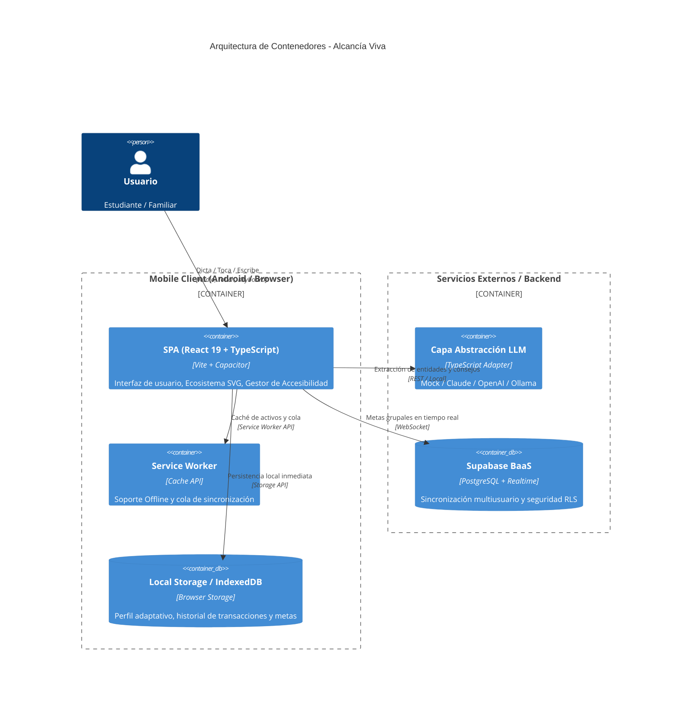

# Alcancía Viva

> **Educación financiera personal con un ecosistema vivo e interacciones no convencionales.**  
> Proyecto desarrollado para el curso **CC451 - Interacción Humano-Computador** | Universidad Nacional de Ingeniería (UNI).

[](https://opensource.org/licenses/MIT)
[](https://developer.android.com/studio)
[](https://web.dev/progressive-web-apps/)
[](https://www.w3.org/WAI/WCAG22/quickref/)
[](https://vitejs.dev/)
[](https://react.dev/)

---

## 1. Descripción del Proyecto

**Alcancía Viva** es una aplicación móvil (Android Studio / PWA) de educación financiera diseñada para superar las barreras de las aplicaciones bancarias tradicionales y las hojas de cálculo. Permite registrar ingresos y gastos mediante **lenguaje natural por voz o texto en menos de 10 segundos**, y transforma los hábitos del usuario en un **ecosistema interactivo vivo** (árbol) que florece con el ahorro y pierde hojas o vitalidad con los excesos presupuestarios, ofreciendo siempre retroalimentación afectiva constructiva y libre de culpa.

El proyecto implementa los tres niveles del **Diseño Emocional de Don Norman**:
1. **Nivel Visceral:** Impacto estético inmediato a través de gráficos SVG vivos, colores orgánicos y micro-animaciones fluidas.
2. **Nivel Conductual:** Registro por voz con confirmación en máximo 2 toques, prevención de errores con opción "Deshacer" en 10 segundos y navegación accesible por teclado o comandos de voz.
3. **Nivel Reflexivo:** Consejos semanales personalizados generados por LLM, detección de patrones de consumo y salas de ahorro colaborativo para familias o amigos con estricta privacidad.

---

## 2. Características Principales

* **Registro Multimodal por Voz y Texto:** Captura por voz utilizando Web Speech API. Entiende expresiones coloquiales peruanas (*"gasté 25 soles en taxi"*, *"almuerzo menú 15 soles"*).
* **Capa de Abstracción de LLM Agnóstica:** Arquitectura desacoplada mediante el patrón Adaptador / Factoría que permite alternar dinámicamente entre **Claude (Anthropic)**, **GPT-4o (OpenAI)**, **Ollama (Local)** o un **Mock Inteligente** local sin dependencias ni costos.
* **Ecosistema Vivo No Convencional:** Metáfora visual en SVG que refleja la salud del presupuesto semanal y el avance de metas en tiempo real.
* **Ahorro Colaborativo en Salas (Multiusuario):** Salas privadas mediante código de invitación donde se comparten metas y aportes colectivos sin revelar transacciones privadas personales.
* **Soporte Nativo Android Studio:** Configurado mediante Capacitor en la carpeta `android/`, permitiendo compilación con Gradle y ejecución en emuladores o dispositivos físicos Android.
* **PWA Offline-First:** Almacenamiento local con sincronización asíncrona mediante cola de eventos al recuperar conexión.
* **Accesibilidad Total (WCAG 2.2 AA):**
  * Soporte completo para lectores de pantalla con `aria-live` y descripción oral del estado del ecosistema.
  * Modo de alta legibilidad / cognitivo simplificado con oraciones directas y barras de proporción visual.
  * Respeto a las preferencias de reducción de movimiento (`prefers-reduced-motion`) y alto contraste.
  * Operación 100% por teclado y táctil optimizada para teléfonos móviles.

---

## 3. Arquitectura del Sistema (Modelo C4)

La arquitectura de Alcancía Viva está documentada formalmente en [`docs/architecture/c4-model.md`](docs/architecture/c4-model.md) mediante diagramas interactivos de Mermaid.

### Vista de Contenedores (C4 Nivel 2)


---

## 4. Guía de Instalación y Ejecución

Consulta la guía completa en [`docs/INSTALL.md`](docs/INSTALL.md).

### Instalación Rápida:

```bash
# 1. Clonar el repositorio
git clone https://github.com/Faalvial/Alcancia-Viva.git
cd alcancia-viva

# 2. Instalar dependencias
npm install

# 3. Copiar archivo de entorno
cp .env.example .env

# 4. Iniciar en modo desarrollo web
npm run dev
```

La aplicación web quedará disponible en `http://localhost:5173`.

### Ejecución en Android Studio:

El proyecto incluye el soporte nativo listo en la carpeta `android/`:

1. Generar la compilación web optimizada:
   ```bash
   npm run build
   npx cap sync android
   ```
2. Abrir el proyecto en **Android Studio**:
   ```bash
   npx cap open android
   ```
   O desde Android Studio, seleccionar **File > Open** y apuntar a la carpeta `android/` del proyecto.
3. Conectar un dispositivo Android vía USB con depuración habilitada o iniciar un emulador (AVD), y presionar **Run 'app'** (`Shift + F10`).

---

## 5. Modo Demostración y Datos Simulados

Para evaluar inmediatamente la aplicación sin configurar API Keys:
1. La aplicación inicia por defecto en modo **Mock LLM**.
2. Presiona el botón **"Demo"** en la barra superior.
3. Se poblarán automáticamente **30 días de transacciones realistas** en soles (`data/mock_data.json`), el historial semanal, dos metas activas (Laptop y Fondo de Emergencia) y la sala de ahorro grupal para el *Viaje a Cusco*.

---

## 6. Mapeo de Requerimientos del Curso CC451

| Requerimiento Rúbrica CC451 | Implementación en Alcancía Viva | Ubicación en el Código |
| :--- | :--- | :--- |
| **Interfases de Voz** | Web Speech API bidireccional (reconocimiento de audio y síntesis TTS con descripción de ecosistema). | `src/services/voice/speechService.ts` |
| **LLM con Abstracción** | Patrón Factoría con soporte intercambiable para Claude, OpenAI, Ollama y Mock sin API Key. | `src/services/llm/` |
| **Plataforma Móvil / Android** | Proyecto nativo Android Studio (Capacitor) y Service Worker PWA instalable. | `android/`, `public/manifest.json` |
| **Personalización Continua** | Perfil persistente adaptativo: vocabulario aprendido, tono emocional y tolerancia al estrés. | `src/types/index.ts`, `data/mock_data.json` |
| **Multiusuario** | Salas colaborativas con código de invitación, aportes en tiempo real y privacidad de gastos. | `src/components/GoalsSection.tsx` |
| **Diseño Emocional (Norman)** | Niveles visceral (SVG reactivo), conductual (registro en 2 toques) y reflexivo (consejos sin culpa). | `src/components/EcosystemSvg.tsx`, `src/components/AdvisorChat.tsx` |
| **Datos Simulados** | Dataset de 30 días con transacciones peruanas, metas y estados de salud. | `data/mock_data.json` |
| **Licencia Open Source** | Licencia MIT explícita en la raíz del repositorio. | `LICENSE` |

---

## 7. Integrantes del Equipo

| Integrantes | Código |
| :--- | :--- |
| **Villanueva Alzamora, Farid Alonzo** | 20234010G |
| **Espinoza Benavente, Hector** | 20222109C |
| **Inga Chavez, Jorly** | 20220467J |
| **Mori Malca, Jean Paul** | 20245016A |

**Curso:** CC451 - Interacción Humano-Computador  
**Universidad Nacional de Ingeniería (UNI)**  
**Periodo:** 2026-II  
