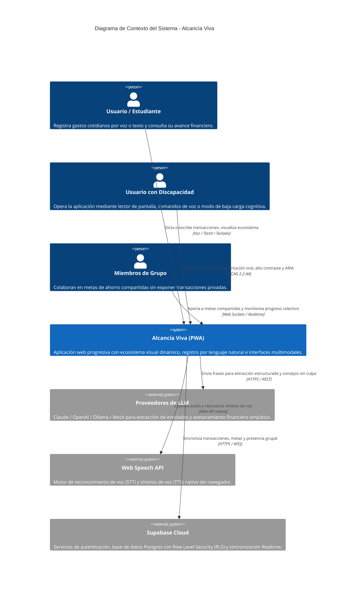
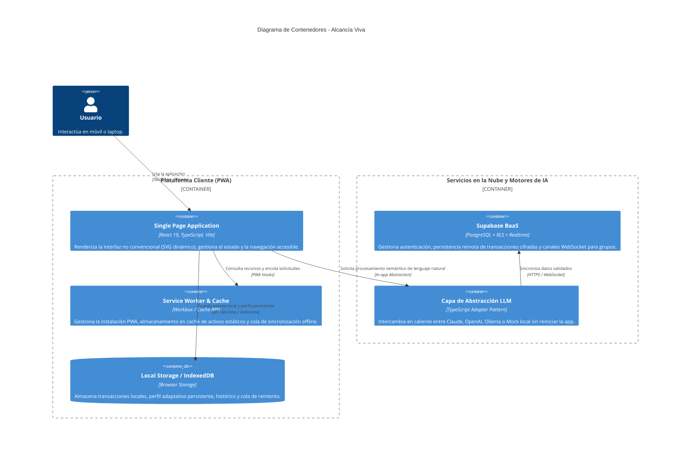
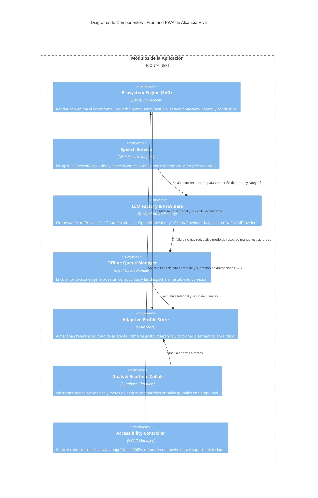

# Alcancía Viva - Arquitectura de Software (Modelo C4)

Este documento detalla la arquitectura de **Alcancía Viva** siguiendo los niveles de abstracción del modelo C4 (Contexto, Contenedores y Componentes), enfocado en la interacción humano-computador, accesibilidad (WCAG 2.2 AA) y desacoplamiento de servicios inteligentes.

---

## Nivel 1: Diagrama de Contexto del Sistema (System Context)

El diagrama de contexto ilustra cómo los distintos usuarios (estudiantes, familias, usuarios con discapacidad visual, auditiva o motora) interactúan con Alcancía Viva y los servicios externos involucrados.

---

## Nivel 2: Diagrama de Contenedores (Container Diagram)

Describe los entornos de ejecución de alto nivel que componen la solución. Alcancía Viva está diseñada como una **Single Page Application (SPA) / Progressive Web App (PWA)** que garantiza funcionamiento offline inmediato.

---

## Nivel 3: Diagrama de Componentes (Component Diagram - Cliente PWA)

Detalla la estructura interna de la Single Page Application dentro del navegador.

---

## Registro de Decisiones de Arquitectura (ADRs)

### ADR-01: Adopción del Patrón Fábrica y Adaptador para LLM
* **Contexto:** La rúbrica exige que el LLM pueda cambiar de proveedor sin modificar los módulos funcionales (NFR-08) y permitir evaluación sin claves pagadas (FR-19, FR-20).
* **Decisión:** Se implementa la interfaz común `ILLMProvider` con soporte para:
  1. `MockLLMProvider`: Motor de reglas y heurísticas semánticas sin costo ni red.
  2. `AnthropicProvider`: Integración con API de Claude 3.5 Sonnet.
  3. `OpenAIProvider`: Integración con API de GPT-4o / GPT-4o-mini.
  4. `OllamaProvider`: Integración con modelos locales (Llama 3, Mistral) vía HTTP local.
* **Consecuencia:** Cero acoplamiento a una sola API comercial y reproducibilidad garantizada para los evaluadores.

### ADR-02: Metáfora Visual Basada en SVG Declarativo
* **Contexto:** Se requiere una interfaz no convencional con diseño emocional (Norman: visceral, conductual, reflexivo).
* **Decisión:** Emplear gráficos vectoriales SVG interactivos manipulados por propiedades React, evitando motores 3D pesados que degradarían el rendimiento en móviles de gama baja.
* **Consecuencia:** Carga instantánea, escalabilidad infinita sin pixelación, soporte nativo de reducción de movimiento (`prefers-reduced-motion`) y descripciones semánticas accesibles vía atributos `role="img"` y `aria-label`.

### ADR-03: Política Offline-First y Almacenamiento Local
* **Contexto:** En escenarios de movilidad en transporte público o mercados de Lima, la conectividad es inestable (PACT A1).
* **Decisión:** Todas las escrituras se consolidan primero en el almacenamiento local (`LocalStorage` / `IndexedDB`) y se despachan a la nube de manera asíncrona mediante una cola idempotente.
